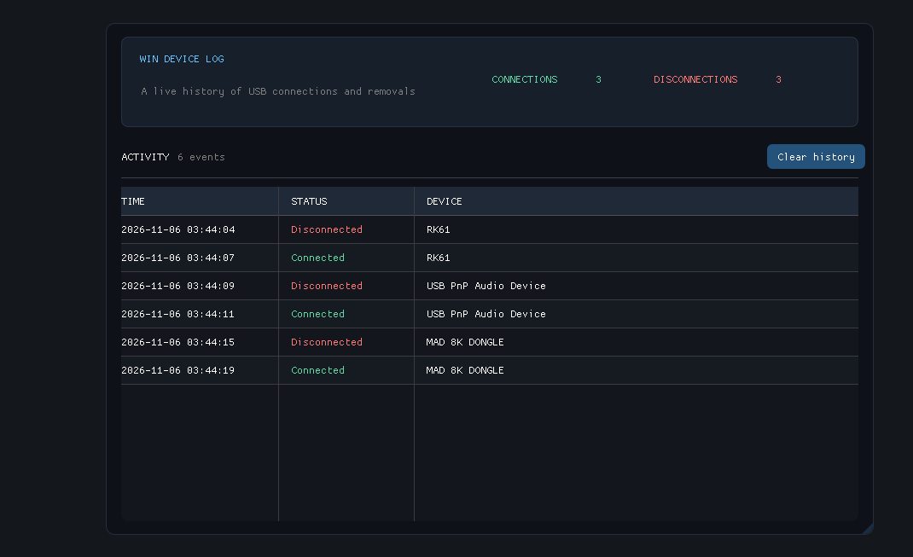

# Win Device Log

I made WinDeviceLog to solve a small problem I had myself: I wanted a quick,
clear way to see when USB devices connect to or disconnect from my PC. 

## Run

After building with the steps below, open `build\Release\WinDeviceLog.exe`.

## Build

Install MSYS2 UCRT64 with `g++` and add its `bin` folder to `PATH`, then
double-click `build.bat` or run it from the project folder. The executable is
created at `build\Release\WinDeviceLog.exe`.

ImGui and the required Win32/DX11 backends are included in `imgui/`; no internet connection is needed.
Device names use the USB-reported product name when Windows provides one, with a
peripheral-type fallback when it does not.
